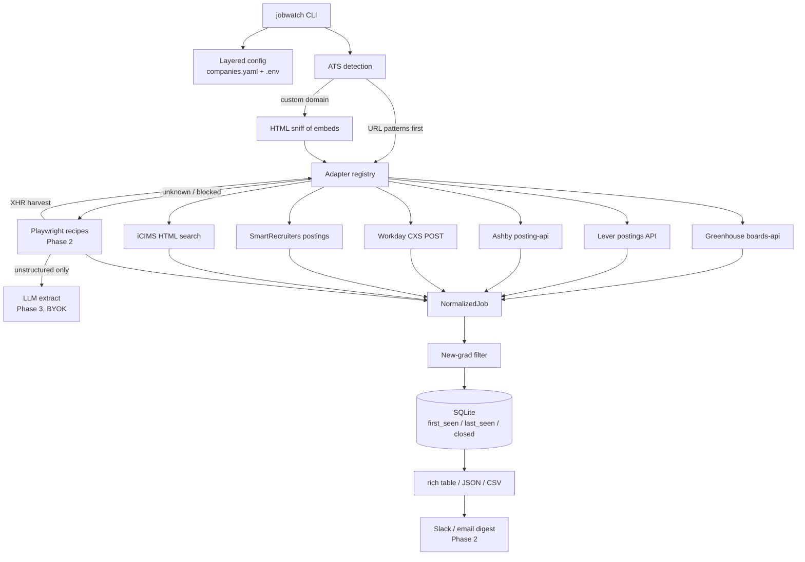

# jobwatch — design

`jobwatch` is a Python CLI that watches a **whitelist of company careers pages**, pulls currently open roles through ATS-native APIs (or an HTML/browser fallback), keeps **new-grad / entry-level** postings, and prints the ones that are **new since the last run**.

It is meant to be installed on `PATH` (`uv tool install` / `pipx`) and run from cron or any scheduler, in the same style as a small daily ops CLI: layered config, `.env` for secrets, one SQLite file for state, per-company failures that do not abort the run.

This document is the architecture. The scaffold in this repo implements Phase 1: detection for all six ATS families below, working adapters with fixture tests, SQLite state, the new-grad filter, and `scan` / `add` / `list` / `detect` / `init`.

---

## 1. Why the proposed architecture, and what we changed

The original sketch (detect ATS → hit public JSON → Playwright recipes → optional LLM → keyword filter → SQLite → rich/JSON) is the right skeleton. A few things were wrong or incomplete:

1. **Do not crawl to detect when the URL already names the ATS.** `boards.greenhouse.io/discord` and `nvidia.wd5.myworkdayjobs.com/en-US/NVIDIAExternalCareerSite` need zero HTML. Crawl (or a later browser pass) only when the careers URL is a custom domain.
2. **Do not treat a cached `ats:` field as immutable.** Lever→Ashby migrations are common. Store the detected ATS as a *hint*. If the adapter 404s, re-sniff once and rewrite the hint.
3. **Normalize at the adapter boundary.** Filter, DB, and output never see Greenhouse `absolute_url` vs Lever `hostedUrl`. Every adapter emits `NormalizedJob`.
4. **Playwright is a last resort, not the daily path.** Headless Chromium on a cron box is slow, brittle, and often blocked anyway. The HTTP adapters are the product. Recipes exist to *discover* a JSON endpoint and graduate it into an adapter.
5. **LLM extraction must not invent jobs.** Use it only when a page rendered and we still have no structured links. Require a URL that already appeared in the page. Off by default, BYOK.
6. **Title keywords miss most new-grad SWE roles.** Many are titled “Software Engineer” with “new graduate” only in the description. Phase 1 therefore supports `scope: all` on campus-only boards, and an optional description pass. The default remains “title must look junior,” because dumping every engineer role is not useful.
7. **Workday is not “just POST and page.”** `limit` must be **20**. `total` is trustworthy on **page 0 only**. Offsets past **2000 wrap** to page 1. Tenant lives in the hostname *or* the path (`myworkdaysite.com`). Locale is a path prefix, not part of the site id.
8. **iCIMS has no public JSON board API.** The official portal search API is authenticated. The reliable unauthenticated path is the iframe HTML search (`ss=1&in_iframe=1`, `pr=` pages). Many tenants still 403/405 or sit behind Cloudflare — those need the browser recipe, and we say so instead of pretending.



Daily `scan` path: load whitelist → isolate each company → adapter.fetch → filter → upsert → print **new** rows (or `--all`).

---

## 2. Repository layout

```
PLAN.md
README.md
pyproject.toml                 # console script: jobwatch
companies.example.yaml
.env.example
src/jobwatch/
  __init__.py
  __main__.py                  # python -m jobwatch
  cli.py                       # typer app
  models.py                    # NormalizedJob, Company, Detection
  config.py                    # layered YAML + env
  http.py                      # polite httpx client
  detect.py                    # URL then HTML sniff
  filter.py                    # include / exclude / description
  store.py                     # SQLite
  output.py                    # rich / json / csv
  pipeline.py                  # scan orchestration
  adapters/
    __init__.py                # registry
    base.py                    # Adapter protocol + errors
    greenhouse.py
    lever.py
    ashby.py
    workday.py
    smartrecruiters.py
    icims.py
  browser.py                   # recipe schema + stub
  llm.py                       # provider-agnostic stub
tests/
  conftest.py
  fixtures/<ats>/...
  test_detect.py
  test_filter.py
  test_cli.py
  test_store.py
  adapters/test_*.py
```

Installable as a tool:

```bash
uv tool install -e .
jobwatch --help
```

---

## 3. Config schema

Search order (first file that exists wins):

1. `--config` / `JOBWATCH_CONFIG`
2. `./companies.yaml`
3. `./.jobwatch/companies.yaml`
4. `$JOBWATCH_HOME/companies.yaml` (default `~/.config/jobwatch`)

Secrets and overrides come from process env, then `./.env`, then `$JOBWATCH_HOME/.env` (never committed). This matches the “layered `.env` + yaml, scheduled daily” style.

```yaml
# companies.yaml
defaults:
  include_title:
    - new grad
    - new graduate
    - new-grad
    - university grad
    - university graduate
    - college grad
    - recent grad
    - recent graduate
    - entry level
    - entry-level
    - early career
    - early-career
    - junior
    - intern
    - internship
    - campus
    - graduate program
    - graduate programme
    - university
    - "2026"
    - "2027"
  exclude_title:
    - senior
    - staff
    - principal
    - director
    - "head of"
    - architect
    - distinguished
    - "vp "
    - manager
    - " lead"
  # Short tokens (lead, jr) are matched on word boundaries in code.
  check_description: false
  description_exclude:
    - "5+ years"
    - "5 years of experience"
    - "7+ years"
  rate_limit_rps: 1.5
  timeout_s: 25
  max_pages: null          # adapter-specific cap; Workday default 100 (2k jobs)

companies:
  # --- Greenhouse ---
  - id: discord
    name: Discord
    careers_url: https://job-boards.greenhouse.io/discord
    ats: greenhouse
    board: discord

  # --- Lever (global). EU boards use jobs.eu.lever.co and region: eu ---
  - id: palantir
    name: Palantir
    careers_url: https://jobs.lever.co/palantir
    ats: lever
    board: palantir

  # --- Ashby ---
  - id: ashby
    name: Ashby
    careers_url: https://jobs.ashbyhq.com/ashby
    ats: ashby
    board: ashby

  # --- Workday (tenant in hostname, locale prefix, site slug) ---
  - id: nvidia
    name: NVIDIA
    careers_url: https://nvidia.wd5.myworkdayjobs.com/en-US/NVIDIAExternalCareerSite
    ats: workday
    host: nvidia.wd5.myworkdayjobs.com
    tenant: nvidia
    site: NVIDIAExternalCareerSite
    locale: en-US
    max_pages: 5            # demo cap; omit to page up to the 2k wrap

  # --- SmartRecruiters ---
  - id: smartrecruiters
    name: SmartRecruiters
    careers_url: https://jobs.smartrecruiters.com/smartrecruiters
    ats: smartrecruiters
    board: smartrecruiters

  # --- iCIMS (classic portal). Attract / Cloudflare tenants will fail HTTP. ---
  - id: fred-hutch
    name: Fred Hutch
    careers_url: https://careers-fhcrc.icims.com/jobs/search?ss=1
    ats: icims
    portal: https://careers-fhcrc.icims.com

  # Campus board: every posting is already in-scope.
  - id: example-university
    name: Example University
    careers_url: https://jobs.lever.co/example
    ats: lever
    board: example
    scope: all
    enabled: false
```

Per-company keys:

| Key | Meaning |
| --- | --- |
| `id` | Stable slug; SQLite key |
| `name` | Display name |
| `careers_url` | What `add` stored; detection input |
| `ats` | Hint: `greenhouse` `lever` `ashby` `workday` `smartrecruiters` `icims` `browser` |
| `board` | Greenhouse token / Lever site / Ashby board / SmartRecruiters company id |
| `host` `tenant` `site` `locale` | Workday |
| `portal` | iCIMS origin |
| `region` | Lever: `global` (default) or `eu` |
| `scope` | `new_grad` (default) or `all` |
| `include_title` / `exclude_title` | Override or extend defaults |
| `enabled` | Skip when false |
| `timeout_s` `max_pages` `rate_limit_rps` | Per-company overrides |

`jobwatch add <url>` fills `ats` plus the identity fields by detection, then appends the file.

---

## 4. Adapter interface

```python
class Adapter(Protocol):
    name: str

    def matches_url(self, url: str) -> bool: ...
    def parse_identity(self, url: str) -> dict[str, str]: ...
    def sniff_html(self, url: str, html: str) -> dict[str, str] | None: ...
    def fetch(
        self,
        company: Company,
        client: httpx.Client,
        *,
        include_content: bool = False,
    ) -> list[NormalizedJob]: ...
```

`NormalizedJob`: `company_id`, `source`, `job_id`, `title`, `url`, `location`, `department`, `workplace`, `posted_at`, `description`, `raw` (optional, not persisted in full).

Errors:

- `AdapterError` — isolated per company; scan continues.
- `NeedsBrowserError` — subclass; printed as “use a recipe / Phase 2,” not a generic HTTP failure.

Registry is a dict keyed by `name`. Detection walks `matches_url`, then `sniff_html`.

---

## 5. Adapters (Phase 1 — implemented)

### 5.1 Greenhouse

| | |
| --- | --- |
| Hosted board | `https://boards.greenhouse.io/{token}` (redirects to `job-boards.greenhouse.io`) |
| API | `GET https://boards-api.greenhouse.io/v1/boards/{token}/jobs` |
| Auth | None on GET |
| Pagination | **None.** One response is the whole board. `meta.total` is a count, not a cursor. |
| Content | `?content=true` adds escaped HTML `content`, `departments`, `offices`. Used only when `check_description` is on. |

Identity: first path segment of `boards.greenhouse.io` / `job-boards.greenhouse.io`, or `?for=` on embed URLs (`greenhouse.io/embed/job_board?for=token`).

Mapped fields:

| Normalized | Greenhouse |
| --- | --- |
| `job_id` | `id` (job post id, not `internal_job_id`) |
| `title` | `title` |
| `url` | `absolute_url` |
| `location` | `location.name` |
| `posted_at` | `first_published` or `updated_at` |
| `department` | first `departments[].name` when `content=true` |

HTML sniff: `boards.greenhouse.io`, `job-boards.greenhouse.io`, `boards-api.greenhouse.io`, `grnh.se`, `gh_jid`, `embed/job_board/js?for=`.

### 5.2 Lever

| | |
| --- | --- |
| Hosted board | `https://jobs.lever.co/{site}` or `https://jobs.eu.lever.co/{site}` |
| API | `GET https://api.lever.co/v0/postings/{site}?mode=json` |
| EU API | `https://api.eu.lever.co/v0/postings/{site}?mode=json` |
| Auth | None |
| Pagination | `skip` + `limit`. **No total.** Stop when `len(page) < limit`. A bare call returns the full list; we still page (`limit=100`) so a huge board cannot blow memory in one shot. |

**Trap:** the wrong region returns **HTTP 200 and `[]`**, which looks like “not hiring.” Detection sets `region: eu` from `jobs.eu.lever.co`. If region is unknown and global returns empty, we try EU once.

Mapped fields:

| Normalized | Lever |
| --- | --- |
| `job_id` | `id` |
| `title` | `text` |
| `url` | `hostedUrl` |
| `location` | `categories.location` (+ `allLocations`) |
| `department` | `categories.team` or `department` |
| `workplace` | `workplaceType` |
| `posted_at` | `createdAt` (epoch ms) |
| `description` | `descriptionPlain` |

### 5.3 Ashby

| | |
| --- | --- |
| Hosted board | `https://jobs.ashbyhq.com/{board}` |
| API | `GET https://api.ashbyhq.com/posting-api/job-board/{board}` |
| Auth | None |
| Pagination | None (full board) |
| Extra | `?includeCompensation=true` is available; we do not need it for filtering. |

Skip postings with `isListed: false` (unlisted / direct-link only).

Mapped fields:

| Normalized | Ashby |
| --- | --- |
| `job_id` | `id` (UUID) or last path segment of `jobUrl` |
| `title` | `title` |
| `url` | `jobUrl` |
| `location` | `location` |
| `department` | `department` / `team` |
| `workplace` | `workplaceType` |
| `posted_at` | `publishedAt` |
| `description` | `descriptionPlain` |

HTML sniff: `jobs.ashbyhq.com`, `api.ashbyhq.com/posting-api/job-board/`.

There is also a job-board GraphQL POST (`/api/non-user-graphql?op=ApiJobBoardWithTeams`). We do not use it; the posting-api is the documented public surface.

### 5.4 Workday (`myworkdayjobs` / `myworkdaysite`)

Workday career sites are SPAs. The list is **not** in the first HTML. The hidden JSON API is:

```
POST https://{host}/wday/cxs/{tenant}/{site}/jobs
Content-Type: application/json
Accept: application/json
Accept-Language: en-US

{"appliedFacets": {}, "limit": 20, "offset": 0, "searchText": ""}
```

**Hard rules we implement:**

| Rule | Why |
| --- | --- |
| `limit` is **20** | 21+ is HTTP 400 or `jobPostings: []` with `total` still set. |
| Read `total` from **offset=0 only** | Later pages often report `total: 0`. |
| Stop on empty, short page, `offset >= total`, or **repeated `externalPath`** | Offsets ≥ 2000 **wrap** to page 1. A naive loop duplicates forever. |
| Default `max_pages=100` | 100 × 20 = the 2,000-row ceiling. |
| Facet split is **not** in Phase 1 | Boards larger than 2k (NVIDIA, Accenture) need `appliedFacets` slices. We warn when `total == 2000`. |

**URL variants parsed by `parse_identity`:**

| Pattern | Example | tenant / site |
| --- | --- | --- |
| `{tenant}.wd{N}.myworkdayjobs.com/{site}` | `adobe.wd5.myworkdayjobs.com/external_experienced` | adobe / external_experienced |
| `{tenant}.wd{N}.myworkdayjobs.com/{locale}/{site}` | `nvidia.wd5.myworkdayjobs.com/en-US/NVIDIAExternalCareerSite` | nvidia / NVIDIAExternalCareerSite |
| `{host}/wday/cxs/{tenant}/{site}/jobs` | either family | path wins |
| `wd{N}.myworkdaysite.com/recruiting/{tenant}/{site}` | AB InBev-style shared host | path |
| `wd{N}.myworkdaysite.com/wday/cxs/{tenant}/{site}/jobs` | same | path |
| Deep job URL | `.../{site}/job/...` | site is the first non-locale segment |

`wd{N}` is a shard (`wd1`, `wd5`, `wd12`, `wd103`, …). It is **not** guessed; we keep the host from the careers URL.

Job URL: `https://{host}/{locale}/{site}{externalPath}` when locale is known, else `https://{host}/{site}{externalPath}`.

Mapped fields:

| Normalized | Workday list row |
| --- | --- |
| `job_id` | last `_JR…` / id in `externalPath`, else the path |
| `title` | `title` |
| `url` | constructed from `externalPath` |
| `location` | `locationsText` |
| `posted_at` | `postedOn` (relative: “Posted Today”) |
| extra | `bulletFields[0]` as requisition id |

Detail descriptions (`GET /wday/cxs/{tenant}/{site}{externalPath}`) are N+1 and Phase 2 `--enrich` only.

### 5.5 SmartRecruiters

| | |
| --- | --- |
| Hosted board | `https://jobs.smartrecruiters.com/{company}` or `careers.smartrecruiters.com/{company}` |
| API | `GET https://api.smartrecruiters.com/v1/companies/{company}/postings` |
| Auth | None for public postings |
| Pagination | `limit` (max **100**) + `offset`. Use `totalFound` from the first page. Stop when `offset >= totalFound` or `content` is empty. **Do not** stop on a short page alone if you mis-read `totalFound`. |
| Filter | `destination=PUBLIC` |

Mapped fields:

| Normalized | SmartRecruiters |
| --- | --- |
| `job_id` | `id` |
| `title` | `name` |
| `url` | `https://jobs.smartrecruiters.com/{company}/{id}` |
| `location` | `city, region, country` or `Remote` |
| `department` | `department.label` / `function.label` |
| `posted_at` | `releasedDate` |

Detail body is `GET /v1/companies/{company}/postings/{id}` (Phase 2 enrich).

### 5.6 iCIMS — best reliable approach, and its limits

**There is no public JSON list endpoint.**

What exists, and why we do not use it as the daily path:

| Surface | Why it is not the adapter |
| --- | --- |
| `api.icims.com/customers/{id}/search/portals/...` | Official Job Portal API. **Basic/OAuth**, customer-scoped. We are not the customer. |
| Standard XML job-board feed | Vendor OAuth, zip delivered 3× daily. Same problem. |
| `/jobs/feed` RSS on some portals | Inconsistent; often missing or login-gated. Tried as a bonus probe only if we add it later. |

**What we implement (HTTP, no browser):**

```
GET {portal}/jobs/search?ss=1&in_iframe=1&pr={page}
User-Agent: desktop Chrome
```

- `ss=1` — unfiltered search.
- `in_iframe=1` — chrome-less results that classic portals actually return as HTML.
- `pr` — **zero-based** page index. Page size is per tenant (20 and 50 are both common). Do not hard-code it.

Parse each `li.iCIMS_JobCardItem` / `a[href*="/jobs/"][href*="/job"]`:

- id from `/jobs/{id}/...`
- title from the `h3` or `title="id - Title"`
- location from the header `dd` next to the map-marker field when present

Stop when:

- the page has no job links, or
- `Page N of M` says `N >= M`, or
- `pr` exceeds `max_pages`

**Limits (documented, tested as errors, not silently empty):**

1. **HTTP 405 / 403** — some tenants reject non-browser or even browser UAs. Raise `NeedsBrowserError`.
2. **Cloudflare / bot management** — challenge HTML, no job cards. Same error.
3. **iCIMS Attract (newer “Career Sites”)** — React apps; the iframe search is a shell. Needs Playwright + a recipe, or a harvested XHR once we see one.
4. **Custom domains** — careers page is `jobs.example.com` wrapping an iframe to `careers-example.icims.com`. URL detection misses it; HTML sniff looks for `icims.com` and `iCIMS_`.
5. **No descriptions on the list.** Title filter only unless we N+1 each `/jobs/{id}/job?in_iframe=1` JSON-LD `JobPosting` (opt-in enrich).
6. **Pager comments lie.** The HTML comments mention `rel="next"` even on the last page. Use visible `Page N of M` or an empty card list.
7. **ToS.** iCIMS (and most ATS) dislike unauthenticated bulk scraping. jobwatch is a personal whitelist monitor with rate limits — keep the list short and the interval daily.

Phase 2 recipe for a blocked tenant:

```yaml
name: example-icims
start: https://careers-example.icims.com/jobs/search?ss=1&in_iframe=1
job_links: "a.iCIMS_Anchor[href*='/jobs/']"
pagination: "a[rel=next], a.iCIMS_Pager_Next"
max_depth: 1
max_pages: 30
harvest_xhr: true
```

---

## 6. Browser fallback recipes (Phase 2)

Not shipped as a hard dependency (`jobwatch[browser]` extra). Schema:

```yaml
# ~/.config/jobwatch/recipes/acme.yaml
name: acme
start: https://careers.acme.com/jobs
wait: networkidle          # or selector: "a.job-card"
job_links: "a[href*='/job/']"
title: "a[href*='/job/']"
follow:
  - "a:has-text('View all jobs')"
  - "a.pagination-next"
pagination: next           # or "scroll" for infinite
max_depth: 2
max_pages: 20
iframe: true               # also search frames
harvest_xhr: true          # dump JSON responses matching job-like keys
timeout_s: 45
```

Driver outline:

1. Reuse one Chromium context per run (cookies, not a new browser per company).
2. Open `start`, wait, collect `job_links`.
3. Follow “view all” / next within `max_depth` / `max_pages`.
4. If `harvest_xhr`, keep responses whose JSON has arrays of objects with `title` + (`url` or `absolute_url` or `hostedUrl` or `externalPath`). Write them under `~/.config/jobwatch/harvest/{company}/` so a human can promote a new adapter.
5. Emit `NormalizedJob` from link text + href when no JSON appeared.

This is how secondary pages (department hubs, “view all”, pagination, iframes) get handled without baking every DOM into Python.

---

## 7. LLM fallback (Phase 3)

Interface (already stubbed in `jobwatch/llm.py`):

```python
class LLMProvider(Protocol):
    def extract_jobs(self, page_text: str, base_url: str) -> list[NormalizedJob]: ...
    def is_new_grad(self, title: str, description: str | None) -> bool | None: ...
```

Rules:

- BYOK via `JOBWATCH_LLM_API_KEY` + `JOBWATCH_LLM_PROVIDER`.
- Extraction only if HTTP + recipe produced **zero** jobs and the page text is long enough.
- Every returned `url` must be a substring of the page or a same-origin join of an href we already saw. Drop the rest.
- Classifier is opt-in for borderline titles (“engineer i”, “associate”) after keyword rules abstain.
- Default off. A scheduled run must stay deterministic and free.

---

## 8. New-grad filter

Order:

1. If `company.scope == all` → keep.
2. Title **exclude** hits, unless a **strong include** also hits (`new grad`, `intern`, `university grad`, `early career`, …). “Staff Software Engineer, University Graduate” stays. “Senior Software Engineer” goes.
3. Title **include** hit → keep.
4. Else drop (default is deny).
5. Optional description pass: drop if experience-years look senior (`5+ years`, `7+ years`) and no junior counter-signal (`0-2 years`, `new grad`).

Matching: case-insensitive; short tokens (`lead`, `jr`, `vp`) use word boundaries so “Leadership Development Program” is not excluded for `lead`.

Company-level `include_title` / `exclude_title` replace the default lists when set (not merged), so a campus board can say `include_title: ["*"]` via `scope: all` instead.

---

## 9. SQLite schema

Default path: `JOBWATCH_DB`, else `./jobwatch.sqlite` if a local yaml was used, else `$JOBWATCH_HOME/jobwatch.sqlite`.

```sql
CREATE TABLE jobs (
  company_id  TEXT NOT NULL,
  source      TEXT NOT NULL,
  job_id      TEXT NOT NULL,
  title       TEXT NOT NULL,
  url         TEXT NOT NULL,
  location    TEXT,
  department  TEXT,
  first_seen  TEXT NOT NULL,   -- UTC ISO
  last_seen   TEXT NOT NULL,
  closed_at   TEXT,
  PRIMARY KEY (company_id, source, job_id)
);

CREATE TABLE scans (
  id          INTEGER PRIMARY KEY,
  started_at  TEXT NOT NULL,
  finished_at TEXT,
  companies   INTEGER,
  fetched     INTEGER,
  new_count   INTEGER,
  errors      TEXT             -- JSON list of {company, error}
);
```

Semantics:

- Successful fetch for company C: upsert current rows (`last_seen` now; `first_seen` set on insert; `closed_at` cleared if it reopened).
- Rows for C not in the fetch: set `closed_at` once.
- A failed company **does not** close its jobs (avoid “everything vanished” on a 503).
- Default CLI output: `first_seen >= this scan's started_at`.
- `--all`: every still-open row that passed the filter this run.

---

## 10. CLI

```
jobwatch --help
jobwatch init [--force]              # copy example yaml + .env into JOBWATCH_HOME or cwd
jobwatch detect <url>                # print ATS + identity, no write
jobwatch add <url> [--name] [--id] [--scope new_grad|all] [--no-probe]
jobwatch list                        # companies in the whitelist
jobwatch scan [options]
```

`scan` flags:

| Flag | Meaning |
| --- | --- |
| `--all` | Print every open match, not only first-seen this run |
| `--json` / `--csv PATH` | Machine output (still prints the table unless `--quiet`) |
| `--company ID` | Repeatable; subset |
| `--no-filter` | Skip new-grad rules (debug / campus audit) |
| `--check-description` | Force description heuristics this run |
| `--config` `--db` | Paths |
| `--quiet` / `-v` | Log noise |

Exit codes: `0` ok, `1` one or more company errors (partial success still printed), `2` usage/config.

Scheduler sketch:

```cron
15 7 * * *  jobwatch scan --json >> ~/jobwatch/latest.json 2>> ~/jobwatch/scan.log
```

Digest hooks (Phase 2) read the same JSON.

---

## 11. Politeness and robustness

- One shared `httpx.Client` per run; HTTP/2 off (ATS CDNs are picky).
- Desktop Chrome UA (iCIMS 405s on `python-httpx`).
- Per-host minimum interval from `rate_limit_rps` (default 1.5).
- Retries on 429 / 502 / 503 / 504 and transport errors, exponential backoff, `Retry-After` honored.
- Per-company `timeout_s`.
- Workday sends `Accept-Language: en-US`.
- Exceptions do not leave the company loop.
- No global scrape-the-internet mode. Whitelist only.

---

## 12. Testing strategy (recorded fixtures)

Live ATS boards change. Tests **never** call the network.

Each adapter has a recorded payload under `tests/fixtures/<ats>/` in the real response shape (trimmed). `respx` mounts the exact URLs the adapter will call.

| Adapter | Fixtures | Assertions |
| --- | --- | --- |
| Greenhouse | `jobs.json`, `jobs_content.json` | field map; `content=true` used only when asked |
| Lever | `postings.json`, `empty.json` | pagination stop; EU fallback after empty global |
| Ashby | `jobs.json` | drops `isListed: false` |
| Workday | `page0.json`, `page1.json`, `wrap.json` | limit 20; total from page 0; wrap stops |
| Workday identity | unit tests, no HTTP | all URL variants above |
| SmartRecruiters | `page0.json`, `page1.json` | offset/limit; URL construction |
| iCIMS | `page0.html`, `page1.html` | card parse; `Page N of M`; 405 → `NeedsBrowserError` |
| detect | unit | every ATS URL family + embed HTML snippets |
| filter / store / cli | unit | include/exclude, first_seen, `detect` / `init` |

A manual live smoke (`jobwatch scan --company discord`) is documented, not gated in CI.

---

## 13. Known hard cases

| Case | What happens | What we do |
| --- | --- | --- |
| Workday `limit>20` | Empty page, looks like no jobs | Force 20 |
| Workday wrap @ 2000 | Infinite duplicates | Seen-`externalPath` set + `max_pages` |
| Workday `total==2000` | Missing tail | Warn; Phase 2 facet split |
| Workday tenant ≠ host label | Shared `myworkdaysite.com` | Parse `/wday/cxs/` or `/recruiting/` |
| Lever wrong region | `200 []` | Region from URL; try EU if unset and empty |
| Greenhouse custom domain + `gh_jid` | We know it is Greenhouse, not the token | HTML sniff for `?for=` / embed JS; else `add` asks for `--board` |
| iCIMS 403/405/CF | No cards | `NeedsBrowserError` |
| iCIMS Attract | SPA | Recipe |
| Taleo / SuccessFactors | Auth XML / OData or heavy JS | Phase 2+ |
| Cloudflare on any host | Challenge page | Recipe; do not mark jobs closed |
| Pagination / “view all” / iframe | Jobs not on the start URL | Recipe `follow` + `iframe` |
| ATS migration | Cached hint 404s | Re-detect once |

---

## 14. Follow-up ATS (not in Phase 1)

Whether a **public, keyless JSON/XML** endpoint exists, as of this writing:

| ATS | Public list? | Endpoint / notes | Priority |
| --- | --- | --- | --- |
| **Workable** | Yes | `GET https://apply.workable.com/api/v1/widget/accounts/{slug}?details=true` — no pagination | Phase 2, easy |
| **Recruitee** | Yes | `GET https://{slug}.recruitee.com/api/offers/` | Phase 2, easy |
| **Breezy HR** | Yes | `GET https://{slug}.breezy.hr/json` — titles only | Phase 2, easy |
| **BambooHR** | Yes | `GET https://{company}.bamboohr.com/careers/list` (JSON; some tenants vary) | Phase 2 |
| **Rippling ATS** | Yes | `GET https://ats.rippling.com/api/v2/board/{slug}/jobs?page=N` (`totalPages`) | Phase 2 |
| **Personio** | XML | `GET https://{slug}.jobs.personio.de/xml?language=en` | Phase 2 |
| **Teamtailor** | RSS / paid API | `{careers-domain}/jobs.rss` is the keyless path; REST needs a token | Phase 2 RSS |
| **Jobvite** | Fragile | Widget/HTML; occasional `/jobvite` JSON. Treat as recipe-first | Phase 3 |
| **Taleo** (Oracle) | No public JSON | `careersection` HTML, sometimes RSS (`/jobsearch.ajax`). Heavy session JS | Recipe / harvest |
| **SuccessFactors** (SAP) | No public JSON | Authenticated OData; career site is a JS app (`/career?career_ns`) | Recipe |
| **Phenom / Avature / ADP** | No | Enterprise career sites, often Cloudflare | Recipe |
| **Oracle Cloud HCM** | No | Similar to Taleo | Recipe |

Phase 2 should add Workable, Recruitee, Breezy, BambooHR, Rippling, Personio, Teamtailor RSS — all are one-file adapters in the same registry. Taleo/SF stay recipes until a harvested XHR is proven stable.

---

## 15. Phased roadmap

**Phase 1 (this repo)**

- Installable `jobwatch` console script
- Detection + adapters: Greenhouse, Lever, Ashby, Workday (variants + paging + wrap), SmartRecruiters, iCIMS HTML
- New-grad filter, SQLite, rich/JSON/CSV, `scan` / `add` / `list` / `detect` / `init`
- Fixture tests
- PLAN + README

**Phase 2**

- Playwright extra + YAML recipes + XHR harvest
- Easy ATS: Workable, Recruitee, Breezy, BambooHR, Rippling, Personio, Teamtailor
- Workday facet split for >2k
- `--enrich` descriptions (Workday / SR / iCIMS detail)
- Slack webhook + SMTP digest from the same scan result
- `jobwatch harvest <company>` to promote a JSON endpoint

**Phase 3**

- BYOK LLM extract + borderline classifier, with URL grounding
- Taleo / SuccessFactors / Jobvite recipes as we meet them
- Closed-role digest (“these new-grad reqs disappeared”)
- Optional `jobwatch serve` snapshot — out of scope unless asked

**Phase 4 (only if wanted)**

- Multi-user / hosted monitor — explicitly not a goal of this CLI

---

## 16. Open questions

1. **Which companies first?** The example file has one live board per ATS so `add`/`scan` can be tried immediately. A real whitelist should be *your* target list (20–40 is a healthy daily run).
2. **Internships vs full-time new grad?** Defaults include `intern`. Easy to drop from `include_title`.
3. **Grad year window?** Defaults include `2026` and `2027`. Update each season.
4. **Slack/email now or Phase 2?** Hooks are reserved in `.env.example` only.
5. **Workday boards over 2,000 roles** — accept the cap + warning, or implement facet split next?
6. **Description fetch on iCIMS/Workday** — slower, better recall for untitled-as-senior new-grad roles. Off until `--enrich`.
